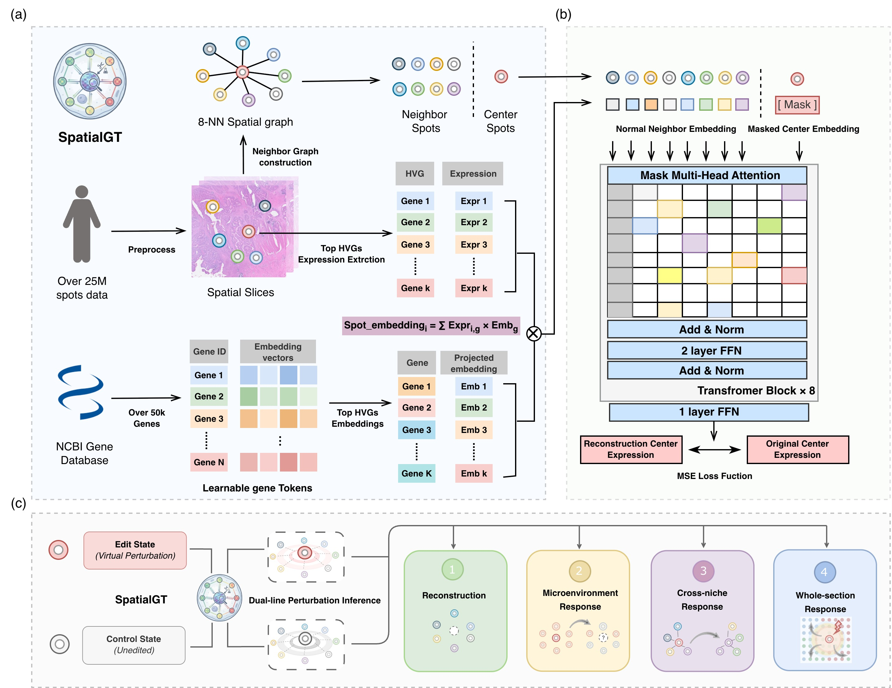

# SpatialGT: Spatial Graph Transformer for Spatial Transcriptomics

<p align="center">
  
</p>

[](https://www.python.org/downloads/)
[](https://pytorch.org/)
[](LICENSE)
[](https://huggingface.co/Bgoood/SpatialGT-Pretrained)
[](https://huggingface.co/Bgoood/SpatialGT-Environment)

## Overview

**SpatialGT** is a graph transformer model for spatial transcriptomics data
analysis. It leverages spatial context through neighbor-aware attention to enable:

- **Spatial Context Learning**: pre-train on large-scale spatial transcriptomics data.
- **Gene Expression Reconstruction**: predict masked gene expression from spatial context.
- **Virtual Perturbation Simulation**: simulate transcriptomic responses to in-silico perturbations.

The released model has **240,040,539 parameters**. Expression-weighted spot representations are processed by eight transformer
blocks and an expression reconstruction head. Gene embeddings are learned from
expression training; no external gene-description embedding matrix is needed.

The public repository is organized around the **SpatialGT Agent UI**, an
interactive application that lets you load your own spatial transcriptomics
data, preprocess a section, configure perturbations, run SpatialGT inference,
and review results — either through natural-language agent control or manual
configuration panels.

## Table of Contents

- [Agent UI](#agent-ui)
- [Environment Setup](#environment-setup)
  - [Option 1: Packaged Environment (Recommended)](#option-1-packaged-environment-recommended)
  - [Option 2: Build From Scratch](#option-2-build-from-scratch)
- [Models](#models)
- [Training and Evaluation](#training-and-evaluation)
- [Tests](#tests)
- [Repository Structure](#repository-structure)
- [License](#license)
- [Contact](#contact)

## Agent UI

The recommended entry point is the Streamlit Agent UI in `spatialgt_agent_ui/`.
It exposes both an LLM **Agent** page for natural-language control and manual
pages for step-by-step configuration. See
[`spatialgt_agent_ui/USER_GUIDE.md`](spatialgt_agent_ui/USER_GUIDE.md) for the
full launch and usage guide.

### Launch The UI

From the repository root, after preparing an environment (see below):

```bash
bash spatialgt_agent_ui/run.sh
```

The launcher automatically detects `environment/spatialgt`. You can also pass a
custom compatible environment and port:

```bash
bash spatialgt_agent_ui/run.sh --spatialgt /path/to/environment/spatialgt --port 8501
```

Then open `http://SERVER_IP:8501`. For remote servers, forward the port over SSH:

```bash
ssh -L 8501:localhost:8501 user@server
```

A Docker workflow is also available from `spatialgt_agent_ui/`:

```bash
docker compose up --build
```

### Configure The Agent

To use natural-language control, provide an LLM API key:

```bash
cd spatialgt_agent_ui
cp .env.example .env
# edit .env and set SILICONFLOW_API_KEY (do not commit .env)
```

With the agent configured, you can drive the entire workflow from the `Agent`
page in plain language, for example: "load this h5ad file", "preprocess and
build the cache", "select target spots by label", "load the pretrained model
from Hugging Face", "apply this DEG file", and "run perturbation inference".

### Typical Workflow

1. Load a user-provided `.h5ad` spatial transcriptomics file.
2. Run preprocessing and build the LMDB cache.
3. Optionally load a label CSV and select perturbation target spots.
4. Load a SpatialGT checkpoint from Hugging Face or a local path.
5. Upload a DEG file or define manual gene edits.
6. Run dual-line virtual perturbation inference.
7. Review convergence curves, the selected step, and saved output paths.

No test dataset is bundled with the UI; you provide your own `.h5ad`, optional
label CSV, and optional DEG file.

## Environment Setup

### Option 1: Packaged Environment (Recommended)

A ready-to-run SpatialGT runtime environment is hosted on Hugging Face so you
can launch the Agent UI without rebuilding the Python stack manually:

[](https://huggingface.co/Bgoood/SpatialGT-Environment)

Download `spatialgt_env.tar.gz`, place it under `environment/` in the
repository root, and extract it:

```bash
mkdir -p environment
huggingface-cli download Bgoood/SpatialGT-Environment spatialgt_env.tar.gz \
    --repo-type model --local-dir environment
tar -xzf environment/spatialgt_env.tar.gz -C environment
```

After extraction, `environment/spatialgt/bin/python` is detected automatically
by the launcher:

```bash
bash spatialgt_agent_ui/run.sh
```

### Option 2: Build From Scratch

If you prefer to build your own environment:

```bash
git clone https://github.com/ai4nucleome/SpatialGT.git
cd SpatialGT

# Create and activate a Python 3.10 environment (conda example)
conda create -n spatialgt python=3.10 -y
conda activate spatialgt

# Install PyTorch with CUDA 11.8
pip install torch==2.2.2+cu118 torchvision==0.17.2+cu118 torchaudio==2.2.2+cu118 \
    -f https://download.pytorch.org/whl/torch_stable.html

# Install core dependencies
pip install -r requirements.txt

# Install Agent UI dependencies
pip install -r spatialgt_agent_ui/requirements.txt
```

Then launch the UI against this environment:

```bash
bash spatialgt_agent_ui/run.sh --spatialgt /path/to/your/conda/envs/spatialgt
```

## Models

Pretrained checkpoint is hosted on
Hugging Face:

| Resource | Description | Link |
|----------|-------------|------|
| SpatialGT-Pretrained | Pretrained on the spatial transcriptomics atlas | [🤗 Hugging Face](https://huggingface.co/Bgoood/SpatialGT-Pretrained) |
| SpatialGT-Environment | Packaged runtime environment | [🤗 Hugging Face](https://huggingface.co/Bgoood/SpatialGT-Environment) |

Download with the Hugging Face CLI:

```bash
# Pretrained model weights (the download contains a checkpoint/ subdirectory)
huggingface-cli download Bgoood/SpatialGT-Pretrained \
    --include 'checkpoint/model.safetensors' --local-dir model/pretrain_ckpt
```

Or from Python:

```python
from huggingface_hub import snapshot_download

snapshot_download(
    repo_id="Bgoood/SpatialGT-Pretrained",
    allow_patterns=["checkpoint/model.safetensors"],
    local_dir="model/pretrain_ckpt",
)
```

The Agent UI can also download a checkpoint from Hugging Face directly when you
load a model.

The gene-ID vocabulary is included as [`vocab.json`](vocab.json) in this GitHub
repository and is available after cloning. Training, preprocessing and the UI
use this file by default. Checkpoint loading accepts the downloaded root,
its `checkpoint/` directory, or a weights file, and validates all model tensors.

## Training and Evaluation

Run the commands below from the repository root. Replace the example paths with
your section and cache locations. The UI can preprocess an `.h5ad` section and
build both HDF5 and LMDB caches. The command-line preprocessing entry is:

```bash
python pretrain/preprocess.py --dataset_list datalist.txt \
    --cache_dir cache/HBRC --max_neighbors 8
```

Use the released gene vocabulary for preprocessing and all subsequent model
calls. `datalist.txt` lists `.h5ad` files or directories containing them, one per
line. For pretraining, configure
the dataset list, cache paths and training budget in `pretrain/Config.py` or a
JSON configuration supplied to `pretrain/run_pretrain.py --config`.

Fine-tuning updates all eight transformer blocks and the expression head by
default. The embedding table, gene projection and mask token remain frozen;
`--unfreeze_embeddings` additionally trains the gene table and projection.

```bash
python finetune/finetune.py \
    --base_ckpt model/pretrain_ckpt/checkpoint \
    --cache_dir cache/HBRC --cache_mode h5 \
    --vocab_file vocab.json \
    --output_dir output/finetune/HBRC --num_epochs 100 --device cuda:0
```

Use `torchrun --standalone --nproc_per_node=N finetune/finetune.py ...` for
distributed fine-tuning. Each process receives a different data shard. For LMDB,
add `--cache_mode lmdb --lmdb_path PATH --lmdb_manifest_path PATH`.

Random-mask reconstruction zeros all selected spots before a single forward
pass. Predictions and scores are saved as **step 1**; this entry supports random
masking only.

```bash
python reconstruction/spatialgt_reconstruction_eval.py \
    --ckpt output/finetune/HBRC --cache_dir cache/HBRC \
    --dataset_name HBRC --cache_mode h5 --n_spots 50 --seed 42 \
    --out_dir output/reconstruction/HBRC_n50_seed42
```

The reconstruction grid uses 50, 100, 150, 300 and 500 masked spots and five
seeds. A setting larger than its section is skipped. Denoising remains a
single full-section forward pass through `reconstruction/denoise_inference.py`.

Within-niche inference uses the original eight-neighbor model. The one-hop
intervention replaces up to eight neighbors. The two-hop intervention uses a
fixed set of sixteen neighbors, divided into inner and outer groups of eight.
Source and target spots are paired randomly within their corresponding group,
and a common random prefix defines increasing replacement counts. The same
pairing and order are reused across intervention strengths.

```bash
python perturbation/microenvironment/microenv_perturbation.py \
    --dataset HBRC --ckpt_dir output/finetune/HBRC \
    --cache_dir cache/HBRC --cache_mode h5 --truth_csv labels.csv \
    --hops 1,2 --k_values_1hop 1,2,3,4,5,6,7,8 \
    --k_values_2hop 1,2,3,4,5,6,7,8,9,10,11,12,13,14,15,16 \
    --alpha_values 0.2,0.4,0.6,0.8,1.0 --max_steps 10 \
    --out_dir output/within/HBRC
```

The UI and mouse-stroke/EC case-study entry points apply log2 fold changes as
`log1p(expm1(x) * 2**logFC)` to log-normalized expression. Directly edited rows
are made nonnegative and held fixed. The fixed-control dual-line update
propagates the response to other spots; its model residuals are not additionally
clipped at each iteration. Automatic selection minimizes the successive-state
MSE over unfrozen spots. The UI displays the change from baseline separately.

## Tests

```bash
python -m unittest discover -s tests -v
```

Tests cover checkpoint loading, training entry points, distributed data
sampling, random-mask reconstruction, the sixteen-neighbor intervention
protocol, and perturbation formulas and step selection.

## Repository Structure

- `spatialgt_agent_ui/`: Agent-driven Streamlit user interface.
- `pretrain/`: SpatialGT model architecture and data bank utilities.
- `finetune/`: Finetuning utilities used by the Agent UI.
- `reconstruction/`: SpatialGT expression reconstruction and denoising scripts.
- `perturbation/`: SpatialGT perturbation case-study scripts.
- `assets/`: Figures and static assets.
- `requirements.txt`: Python dependency list for source installations.

Large assets (model checkpoints, example data, outputs, and
packaged environments) are hosted on Hugging Face and intentionally excluded
from this repository.

## License

This project is licensed under the MIT License. See [`LICENSE`](LICENSE).

## Contact

For questions and issues, please open a GitHub issue or contact
[yxu662@connect.hkust-gz.edu.cn](mailto:yxu662@connect.hkust-gz.edu.cn).
